# TradeMirror

### Understand your trades. Improve your edge.

**A clearer view of your trading — from executions and costs to the patterns behind your decisions.**

TradeMirror is being built as a trading journal and performance analytics platform for Indian options traders. The goal is to bring trade history, charges-aware P&L, session comparisons, and AI-assisted behavioural reviews into one focused workspace.

> **Current status: Free-only V1 candidate — computed reviews, saved snapshots, Zerodha statement costs and journal export implemented; paid AI disabled.**
> Account analytics use saved executions; public demos use synthetic data. Migration `202610100004_report_snapshots.sql` is applied. Statement net is shown separately from FIFO execution gross: costs are not allocated to individual slices or days. Paid AI is excluded from the current free-only scope and disabled server-side by default. No AI API key is required. Earlier phase entries below are historical status records.

## Interactive demo refresh — 22 October 2026

The demo uses a soft charcoal workspace, compact single-row desktop scope toolbar, segmented navigation and responsive range controls. All history / Last 7 days / Last 14 days update the existing chart, metrics, broker summary and journal scope together. Ranges are inclusive calendar days anchored to the latest recorded exit, not today's date; the control explains this for historical/demo data. Small card hover feedback respects the existing reduced-motion override. Account calculations and exports retain exact precision.

Validation: 85 tests, lint, TypeScript and production build pass. Actual production-build browser interaction verified Last 7 days → 16 slices / INR 820.00, All history → 48 slices / INR 2,800.00, plus Metrics open/close. Desktop visual review and effective 390px responsive review passed with document width equal to viewport width. This is emulation, not physical-device acceptance. Existing hosted download receipt and phone-device limits remain open. Next: verify deployed refresh and run actual device acceptance.

## Hosted follow-up — 22 October 2026

The deployed demo now has fresh desktop acceptance for instrument/option journal drilldowns, scoped weekly comparison links, the Metrics popup and cumulative chart selection. No errors were returned by the captured console query. See the [hosted acceptance record](docs/HOSTED_ACCEPTANCE_2026-10-22.md).

Filtered CSV receipt remains unverified after a bounded download-event timeout; browser security policy prevented checking download history. The requested phone viewport did not take effect in this run, so no new mobile pass is claimed. Next: confirm CSV receipt in the normal browser and run physical-device acceptance. This is a documentation-only checkpoint; existing 84-test/build validation remains applicable.

## Current precheck — 22 October 2026

Existing modules and domain models have been rechecked: 84 tests, lint, explicit TypeScript and production build pass. The interrupted scope-navigation fixes are recovered: dashboard/calendar/period drilldowns retain filters; demo dates reflect actual history; calendar amounts and browser colors are consistent. No new feature module, paid service or database migration is introduced.

See the [precheck findings and remaining acceptance](docs/PRECHECK_2026-10-22.md). The browser connection recovered during the 19 October checks, superseding the older connection-blocker notes below. The interrupted filtered-download receipt and physical-device checks remain pending; no fresh hosted-owner acceptance is claimed.

## Current release checkpoint — 15 October 2026

Desktop V1 acceptance is complete for the implemented free scope: owner imports, snapshots, real Zerodha statement persistence, all export families and actual browser-generated PDF. Chrome phone-size layout/navigation checks also pass. Physical iOS/Android file selection, download and print/share checks are deferred because no devices are connected. This is not a claim of native-app or physical-device certification.

See the [current acceptance matrix](docs/V1_RELEASE.md) and [deferred checks / next-session note](docs/V1_HANDOFF.md). The dated entries below preserve development history; their older blockers are superseded by this checkpoint and the current matrix.

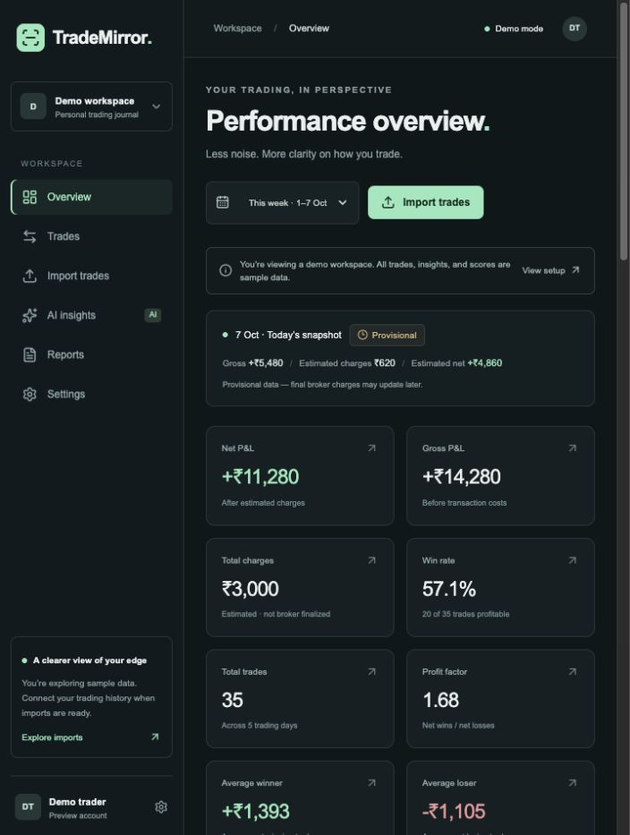

## Scope toolbar alignment — 15 October 2026

Scope counts stay next to the label on desktop and on a dedicated left-aligned line on phones. Unfiltered scopes read “48 matched slices” rather than repeating “48 of 48”. Reset filters appears only when a filter/day selection is active, alongside the right-aligned Metrics control. Validation: lint, TypeScript, production build and initial demo toolbar markup checks pass. Live visual/interaction acceptance remains pending browser recovery.

## Final demo redesign — 15 October 2026

The demo now has a restrained header with sample-data scope, four core metric cards, underline navigation and a chart-led overview. Scope filters are collapsed until requested on desktop and mobile. Win/loss results omit duplicate monetary totals already shown by broker; broker and instrument summaries share a supporting row on wide screens. Compact day highlights stack on phones. Existing chart modes, calendar, breakdowns, comparison, export and top Metrics info remain available. Styles are scoped to the demo; account analytics retain their full metrics.

Validation: 80 tests, lint, TypeScript and production build pass; rendered demo checks confirm scope labels, four metrics, retained chart/broker controls and login links. Browser hover/mobile visual acceptance remains pending the connector recovery. Next session: live desktop/phone visual review; no further modules are required for this visual phase.

## Compact broker summary and top info — 15 October 2026

Moved the Metrics info control into the top Analysis scope bar; its popover opens below the control. Broker cards now show a compact Profit / Loss / Total gross row, slice count and win/loss counts, with a sample label in demo. The section subtitle retains the before-charges disclosure; calculation details remain in the info control. Validation: lint, TypeScript, build and rendered demo checks pass. Live hover/mobile visual acceptance remains pending the browser connector recovery.

## Demo intro polish — 15 October 2026

Replaced the oversized promotional intro with a compact heading, one-line sample-data explanation, a three-step onboarding row and a subtle Home link. The header wraps for narrow screens and keeps the existing login/signup actions in the demo banner. Validation: lint, TypeScript, production build and rendered demo heading/link checks pass. Browser visual acceptance remains deferred until the connector recovers.

## Metric info control — 15 October 2026

The long metric definitions are now behind a compact info button. Hover or click/tap opens the explanation; Close, Escape or moving focus outside dismisses it. Keyboard users can open it with the button. The same calculation disclosure remains available in demo and account views. Validation: lint, TypeScript, production build and server-rendered info-control markup checks pass. Live hover/touch acceptance remains pending browser access recovery.

## Compact demo — 15 October 2026

The demo opens with a short explanation and direct Log in / Create account actions. The first screen focuses on four core metrics; full account analytics retain all eight. The demo instrument list shows the top five contracts, with complete results available in Breakdowns. Sample data remains labelled and separate from account data. Validation: lint, TypeScript, production build and demo/login route response checks pass; live browser visual acceptance remains pending the connector issue. Next: mobile visual acceptance.

## Broker performance — 15 October 2026

The overview now shows one card per recorded broker with gross winning P&L, gross losing P&L, total realized gross P&L and slice outcome counts. These cards follow the existing analysis filters and reconcile using exact decimal arithmetic; displayed money uses two decimals. Same-symbol executions from different brokers remain separate. The demo shows a clearly labelled synthetic broker.

This does not add new broker import adapters: current production imports support Zerodha F&O. Only saved matched executions appear; open positions and charges are excluded, so broker net P&L is not inferred. Validation: 80 tests, lint, TypeScript and production build pass; public demo response checked. Live browser interaction/mobile visual acceptance remains blocked by the browser connection issue. Next: verify cards with owner-imported data and add additional broker adapters when actual export samples are available.

## Supplied reference palette — 15 October 2026

Applied the neutral roles from the user-provided CSS: black page/header, #0f0f0f secondary surfaces, #1f1f1f panels, #2e2e2e inputs/hover, #3d3d3d borders/tooltips and #dbdbdb primary text. Secondary labels use lighter grey for readability. The supplied system/Trebuchet font stack and tabular numbers are applied. Existing blue/teal accents remain because their primitive hex definitions were absent from the paste; red bars use the supplied #f23645 with a lighter red for small loss text.

Validation: lint, TypeScript and production build pass; landing/demo route and generated stylesheet checks pass. Browser visual acceptance remains pending the previously reported connector failure. Next: inspect the neutral palette on desktop and phone when browser access is restored.

## Charcoal theme refinement — 15 October 2026

Inspired by the requested [TradingView reference](https://in.tradingview.com/), the workspace now uses neutral charcoal surfaces, clear grey borders, restrained blue controls and teal/red result states. Smaller corner radii, flat cards, readable secondary labels and visible keyboard focus replace the previous blue-tinted slate styling. Money rounding, charts and responsive layouts remain in place.

Validation: ESLint, TypeScript and production build pass. Live browser visual/interaction acceptance remains blocked by the browser connector’s request-header policy error; physical-device checks are still pending. Next: desktop/phone visual acceptance and any spacing adjustments based on that review.

## Visual refresh — 15 October 2026

Brightness adjustment: bright white surfaces have been replaced with muted slate panels, softer text and restrained indigo controls. The chart and two-decimal fixes remain in place. Lint, TypeScript and production build pass; live visual acceptance remains pending the browser connector recovery.

The demo and account workspace now use a low-glare slate, responsive theme with indigo navigation, consistent green profit/red loss states, clearer cards and sentence-case labels. Dashboard money displays round to two decimal places using decimal-safe rounding (₹58.33333333 → ₹58.33); calculations, exports and the chart’s explicitly labelled exact-values table retain their original precision.

Daily bars use the sign of each day’s gross result; cumulative results use an indigo line. Chart mode changes reset the plotted chart, with a compact tooltip and no oversized hover overlay or entry animation. Best/worst dates use readable IST labels and trading-day counts distinguish green/red days.

Validation: 79 tests, ESLint, TypeScript and production build pass. Browser interaction/visual acceptance is deferred: the browser connector could not load its request-header policy. Tab and hover changes still need a live browser check; physical-phone acceptance remains pending. Next step: verify the refreshed demo on desktop and phone, including both chart modes and calendar selection.

## Latest expansion — six ordered modules

Period comparison, saved journal review, multi-template plans and recorded risk, transparent process tracking, an opt-in broker sync pilot, and PWA support are implemented in six separate commits. Plan/risk storage is live with verified owner RLS and hosted save/reload/export acceptance. Broker sync remains disabled pending supported owner API configuration; it is not automatic multi-user OAuth. PWA install prompts/manifest are live; physical-device install/offline acceptance remains deferred.

See [module status, commit order and remaining prerequisites](docs/MODULE_BATCH.md). No paid API or broker subscription has been enabled.

## Live deployment

- **Website:** [trademirror-ten.vercel.app](https://trademirror-ten.vercel.app)
- **Interactive demo:** [Try without login](https://trademirror-ten.vercel.app/demo)
- **Dashboard:** [Open account dashboard](https://trademirror-ten.vercel.app/dashboard)
- **Vercel project:** `trademirror` in `vkesirariwork-2297s-projects`
- **Git source:** this repository, `main` branch. Future pushes trigger Vercel deployments.
- **Mode:** authenticated workspace. Supabase is connected; signed-out workspace requests redirect to login. Account CSV imports and gross FIFO analytics are active.

First deployment completed on 7 October 2026 from commit `bfec0f9`; landing page and dashboard verified in the browser. Before activating authentication, set the public Supabase variables and `NEXT_PUBLIC_SITE_URL=https://trademirror-ten.vercel.app`, apply the database migration, and configure that origin in Supabase Auth.

## Product flow

### What works today

Configured account flow:

```text
Sign up / log in → Import CSV → Local validation preview → Save executions
                                                        ↓
                         Exact FIFO matching → Gross dashboard + IST daily chart
                                                        ↓
                           Filtered matched journal → Download matching slices
```

The account dashboard reads saved executions and computes gross FIFO metrics. Broker statement costs and realized net have a separate XLSX import flow; execution/day net remains unavailable without a defensible allocation. Hosted owner statement preview/save/repeat-save/reload acceptance passed on 15 October 2026. The public `/demo` workspace works with or without Supabase configuration and uses an independent synthetic 48-slice fixture. It includes analytics, journal, computed review and daily/weekly report pages without login. The older unconfigured sample screens follow this separate flow:

```text
Landing page → Explore demo → Dashboard
                              ├─ Search/filter trades → Trade detail → Demo notes
                              ├─ Import preview → Broker card / local CSV selection
                              ├─ Sample behaviour insights
                              ├─ Daily / weekly report previews
                              └─ Settings & report lifecycle explanation
```

With Supabase configured, signup/login use server actions, email confirmation establishes a session, and workspace routes require a validated user. Without configuration, forms show a setup notice and no credentials are sent to a provider. CSV selection and parsing stay local; previews show the selected file’s actual executions.

### Planned end-to-end experience

```text
Sign up / log in
      ↓
Upload Zerodha tradebook → Preview → Validate → Deduplicate → Import
      ↓
Normalize executions → Match trades → Calculate metrics in code
      ↓
Dashboard → Trade details & notes → Behaviour insights → Daily / weekly review
```

A later broker workflow will add:

```text
Connect broker → Sync executed trades → Provisional daily report
                                              ↓
                             Reconcile confirmed final broker data
                                              ↓
                                  Finalized report → Updated review
```

Charges remain estimated while a report is `PROVISIONAL`. A report becomes `FINAL` only when confirmed final broker data is available. Finalization will not depend on a hard-coded time such as 7:30 PM. Exact broker capabilities and data availability must be verified during integration.

## What is built

| Area | Current behaviour |
| --- | --- |
| Landing | Product introduction, workflow, demo and signup entry points |
| Dashboard | Shared scope filters; exact gross P&L, win rate, profit factor, expectancy, averages and closed-slice drawdown; calendar drill-down; five breakdown dimensions; charts and residual lots |
| Journal | Instrument, side, result and exit-date filters; pagination; per-slice detail dialog with source identities; filtered CSV export; calendar-to-day navigation |
| Trade detail | Account journal dialog: exact prices, quantities, timestamps, holding time and source identities. Notes, tags and a three-item plan review editor implemented; production persistence enabled by the applied journal migration; older sample detail pages are demo-only |
| Imports | Zerodha CSV validation/preview, account-owned atomic save, cross-file duplicate protection and import history; broker connection remains a preview |
| Review | Computed observations, date-scoped tagged strategy comparisons and evidence drilldowns; consent-based AI adapter awaits live server setup |
| Reports | Daily/weekly gross reviews, JSON/CSV export, browser print and immutable snapshot storage; save/reload acceptance pending |
| Settings | Profile persistence, recovery and portable journal/plan JSON export; restore unsupported |
| Foundation | Responsive navigation, loading UI, invalid-trade 404, normalized types, broker adapter contract |

In the unconfigured demo, the dashboard period selector changes summary cards between the sample day and week. Charts and breakdowns are explicitly labeled as the sample week. Fixtures cover 1–7 October 2026; they are not live market data.

## Phase-by-phase diagrams

This is the current implementation map as of **10 October 2026**. **Active** means implemented and available; **acceptance pending** means a remaining live check, not a completed V1 release. The progress log below records historical milestones.

### User journey — demo to personal workspace

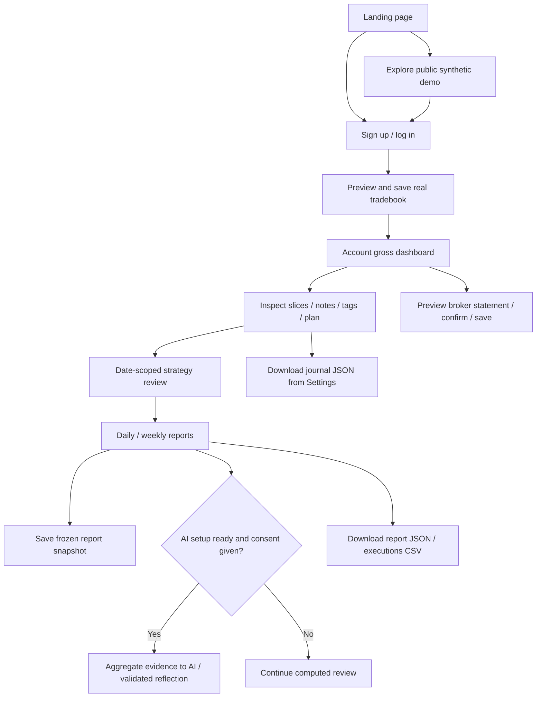

The public demo never reads or writes personal history. AI shares only selected period aggregates after consent. Statement net and execution gross remain separate.

### Phase 1 — frontend foundation · complete

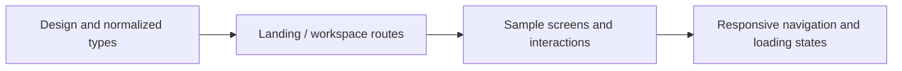

**Delivered:** workspace foundation, then the midnight/violet theme, mobile navigation and scrollable journal. **Next:** retain physical-device acceptance as a release check.

### Phase 2 — authentication and ownership · active

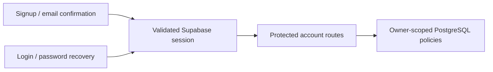

**Delivered:** login, confirmation, recovery, profile settings and owner isolation. The owner confirmed login. **Boundary:** account credentials stay in the authentication flow; public demo records are separate.

### Phase 3 — tradebook import · active

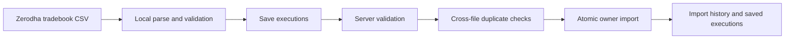

**Delivered:** exact value validation, repeated/overlapping import protection and visible save results/history. **Boundary:** preview alone does not persist data; conflicting source records fail rather than overwrite history.

### Phase 4 — matching and reconciliation · FIFO active

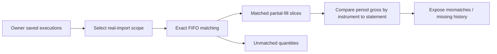

**Delivered:** exact matching, long/short slices, partial fills and residual lots; statement comparison is implemented. **Pending:** broker-certified settlement reconciliation. Slice counts are not whole-position counts.

### Phase 5 — gross metrics and broker costs · implemented, acceptance pending

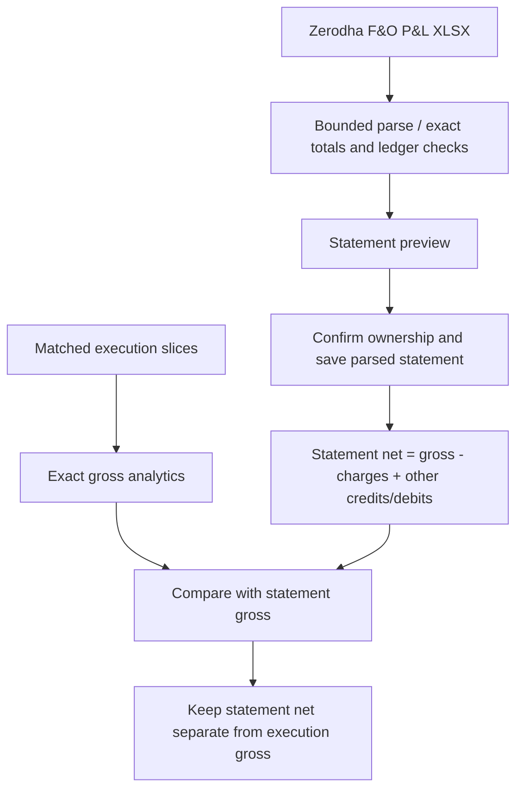

**Delivered:** statement charges, signed adjustments and realized net; independent local source validation. **Pending:** owner statement upload/save/reload acceptance. **Limit:** no day/slice cost allocation or unrealized P&L inference.

### Phase 6 — personal dashboard · active

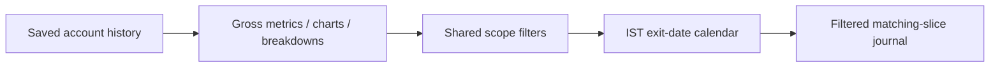

**Delivered:** real-history dashboard, gross ratios, closed-slice drawdown, breakdowns and calendar drilldowns. **Limit:** execution net remains unavailable until a defensible cost allocation exists; the 30-second product target is not measured.

### Phase 7 — journal and strategy review · active

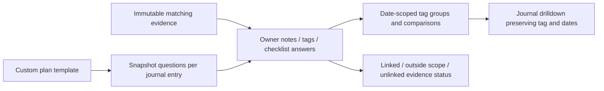

**Delivered:** persistent journal, custom plan, tag filters, comparisons and read-only connection status. **Limit:** changed evidence does not inherit old notes; manual reassignment and multiple templates remain planned.

### Phase 8 — optional AI reflection · excluded from free-only V1

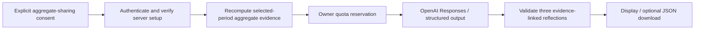

**Delivered:** server adapter, consent, bounded output and quota tests. **Free-only scope:** disabled by default; no provider setup or live AI acceptance is required for this edition. A future explicitly authorized paid integration would need server setup and provider acceptance. No raw CSV, symbols, account identity, notes or tags are sent. Output is page-local until downloaded; it is not saved automatically as a snapshot.

### Phase 9 — reports and portable copies · implemented, acceptance pending

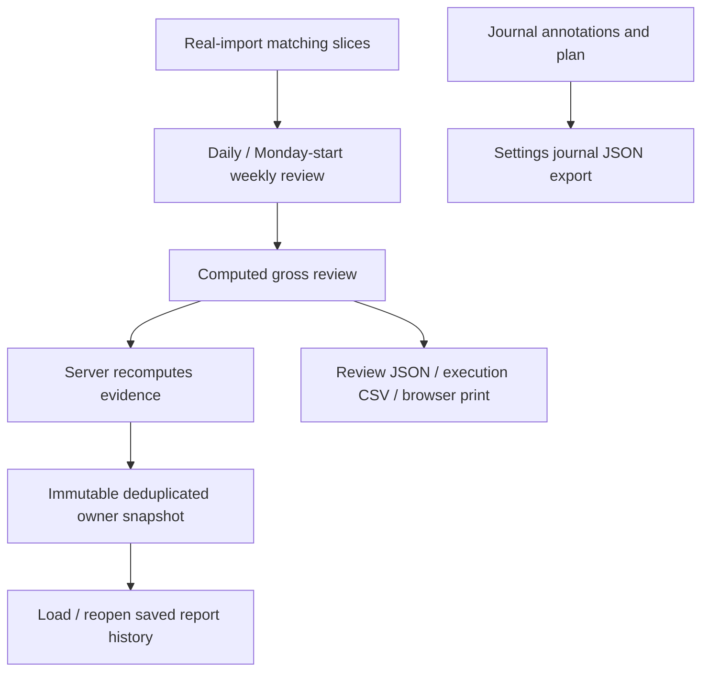

**Delivered:** computed reviews, applied snapshot storage and export controls. **Verified live:** owner history loads; journal export returns prepared status. **Verified live:** snapshot save/reload/reopen and unchanged-evidence deduplication. **Pending:** actual downloaded-file receipt/content and print/PDF acceptance. Journal JSON is not a complete account backup; restore is unsupported.

### Phase 10 — release acceptance and onboarding · in progress

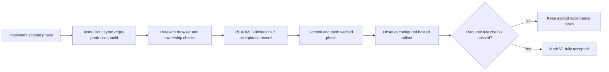

**Latest implementation validation:** 44 tests plus lint, TypeScript and Webpack production build passed. Six-step onboarding and hosted routes are verified. **Open checks for free-only V1:** private statement upload, export receipt/print and remaining physical-mobile acceptance. Snapshot save/reopen/deduplication passed. Paid AI is optional and excluded. See [V1 acceptance checklist](docs/V1_RELEASE.md). Documentation-only diagram updates use Markdown/link/diagram checks rather than rerunning the unchanged app build.

### Planned next versions

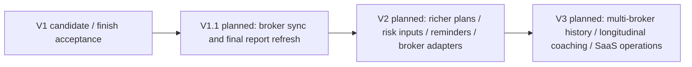

Some originally proposed V2 basics—notes, tags, one custom plan, comparisons and snapshot history—have already shipped in V1. Richer capabilities still need their own inputs and acceptance. Sync, market replay/MFE/MAE, discipline scoring, billing and automated trading are not active; order execution is outside the current roadmap.

### Data relationship map — simplified ER diagram

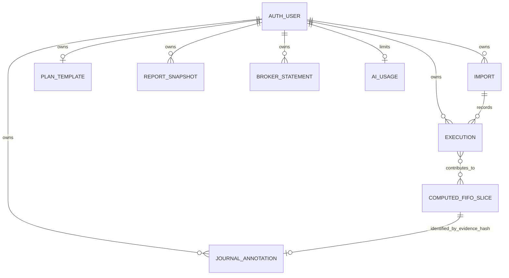

This is a conceptual map, not a literal database schema: FIFO slices are computed from executions, and annotation links use an evidence hash rather than a slice foreign key. Snapshots freeze summary payloads; broker statements store parsed totals and breakdowns. Raw source workbooks are not retained by the statement flow.


## Version roadmap

The roadmap is a proposed sequence, not a release-date commitment. Later versions will be refined after the previous milestone is validated.

### V1 — A reliable trading journal

**Target:** upload a Zerodha CSV and review a trustworthy performance dashboard, with a target of approximately 30 seconds for a typical tradebook. This target is not yet measured.

| Phase | Scope | Status |
| --- | --- | --- |
| 1 | Frontend foundation, design, routes, sample data, normalized types | **Complete** |
| 2 | Supabase authentication, PostgreSQL schema, user isolation and access policies | **Connected; login accepted** |
| 3 | Zerodha CSV parsing, validation, import history, duplicate protection | **Parsing, saving and history active; owner upload verified** |
| 4 | Deterministic trade matching, partial fills, open positions, reconciliation | **FIFO active; statement comparison implemented; certified settlement reconciliation pending** |
| 5 | P&L and cost analytics with explicit estimated / confirmed cost handling | **Gross metrics and statement costs/net active; hosted owner persistence accepted** |
| 6 | Connect the dashboard and filters to actual user data | **Gross dashboard and matched journal connected; net analytics pending** |
| 7 | Persistent notes and trade detail metrics supported by available data | **Notes, tags, custom plan and strategy comparisons active** |
| 8 | AI behaviour interpretation from computed, structured metrics | **Optional adapter retained; disabled and excluded from free-only V1** |
| 9 | Daily / weekly review generation and report history | **Computed reviews and snapshot history active; hosted save/reload accepted** |
| 10 | End-to-end validation, security checks, deployment and onboarding | **Desktop free V1 accepted; physical-device checks deferred** |

### V1.1 — Zerodha sync & final reports

- Verify supported broker APIs and authorization requirements, then implement the first adapter.
- Import executed trades and reconcile them with existing imports without duplicates.
- Support repeated synchronization, connection expiry, retries, and visible sync status.
- Refresh provisional reports when confirmed final data becomes available.
- Preserve report revisions so users can understand why net P&L changed.

Broker sync follows a reliable normalized import and matching engine. No real broker connection exists yet.

### V2 — A stronger review workflow

Proposed scope:

- Persistent trading plans and journal tags, with comparison against recorded rules.
- Evidence-based discipline scoring with transparent definitions and sufficient input data.
- Longer-term session, instrument, cost, and holding-time comparisons.
- Review history, PDF export, and user-controlled reminders.
- Additional broker adapters after verifying their supported data and integration requirements.

MFE, MAE, early-exit flags, and stop-loss violations will require suitable price or plan data. Missing inputs must remain unavailable rather than inferred from a tradebook alone.

### V3 — A mature performance workspace

Proposed direction, subject to user feedback:

- Unified history and reconciliation across supported brokers.
- Configurable review rules and personal progress tracking over time.
- Longitudinal coaching grounded in verified metrics and journal context.
- Reliable background synchronization, observability, and data-quality tooling.
- Production SaaS operations: billing, account export/deletion, recovery, and scale testing.

The product remains focused on trading reflection and analytics. Live signals, buy/sell recommendations, and automated order execution are outside the current roadmap.

## Development & delivery flow

Each phase follows the same loop:

1. Define the phase scope and acceptance criteria.
2. Implement the smallest complete milestone.
3. Run checks appropriate to the change; validate relevant UI and data behaviour.
4. Update this README with completed work, current limitations, validation results, and the next phase.
5. Commit the verified phase and push it to `main` in this repository.

Phase-by-phase pushes are authorized for this project. Each completion update should include the commit and any remaining blockers. Secrets, credentials, environment files, build outputs, and installed dependencies must not be committed. Publishing/deployment remains a separate action from a Git push.

## Progress log

| Milestone | Date | Result |
| --- | --- | --- |
| Phase 1: frontend foundation | 7 October 2026 | All requested demo routes built; lint, TypeScript, production build, route checks, journal filters, report tabs, and mobile navigation verified. Initial implementation commit: `be1d940`. |
| Documentation & roadmap | 7 October 2026 | Added current/planned product flows, V1–V3 roadmap, delivery workflow, limitations, and project description. |
| Phase 2: auth & database foundation | 7 October 2026 | Supabase integration, protected accounts, migration and access-policy tests implemented; hosted activation pending. |

**Current work:** Phase 2 is connected locally and on Vercel. The hosted migration is applied; all nine tables have RLS. Email/password signup and email confirmation are enabled. Signed-out redirects and anonymous table denial passed. The owner confirmed successful login. Password recovery and editable account settings are available.

**Next implementation step:** Implement the validated Zerodha CSV preview and parsing pipeline (Phase 3), followed by trusted persistence and duplicate protection.

## Run locally

Use **Node.js 20.19 or newer**; Node 24 is recommended and selected by `.nvmrc`.

```sh
# If using nvm:
nvm use

npm install
npm run dev
```

Open [localhost:3000](http://localhost:3000). For an existing lockfile, `npm ci` gives a reproducible install.

```sh
npm run lint
npm run typecheck
npm run build
npm start
```

`npm start` runs the production build; run `npm run build` first. The unconfigured sample demo requires no keys. For real authentication, follow [Supabase setup](supabase/README.md) and configure `.env.local` from `.env.example`. Never commit that file.

## Routes

| Route | Purpose |
| --- | --- |
| `/` | Landing page |
| `/login`, `/signup` | Signup/login with configured Supabase; setup notice otherwise |
| `/auth/confirm` | Confirmation / recovery PKCE callback with fixed app destinations |
| `/forgot-password`, `/reset-password` | Email recovery and authenticated password update |
| `/dashboard` | Performance overview |
| `/trades` | Searchable and filterable journal |
| `/trades/tm-1` | Example trade detail; sample IDs `tm-1` through `tm-8` |
| `/import` | Broker / CSV preview |
| `/insights` | Sample behaviour insights |
| `/reports` | Daily / weekly previews |
| `/settings` | Profile and broker connection preview |

## Stack & architecture

Current stack: Next.js 16.4 App Router, React, TypeScript, Tailwind CSS, Recharts, and Lucide. Implemented integration: Supabase Auth / PostgreSQL (connected). Planned service: an AI interpretation API.

| Location | Responsibility |
| --- | --- |
| `app/(workspace)/` | Shared demo layout and workspace routes |
| `components/` | Reusable UI, charts, journal, reports, and broker cards |
| `types/index.ts` | Normalized trades, orders, users, connections, metrics, insights, and report states |
| `data/mock.ts` | Sample fixtures, separate from components |
| `lib/analytics/` | Formatting today; deterministic matching and analytics in later phases |
| `lib/brokers/adapter.ts` | Future broker adapter contract |

Future implementations belong in `lib/brokers/adapters/`. Normalized trades must remain independent of broker payloads; `rawDataId` provides a reference for separately stored raw records. The initial migration and row-level policies are in `supabase/migrations/`. Setup and hosted acceptance checks are in `supabase/README.md`.

### Core rules

- Calculate metrics in deterministic code; let AI interpret structured results.
- Keep calculation engines outside UI components.
- Isolate data by authenticated user and enforce access at the database layer.
- Keep estimated charges visibly distinct from confirmed charges.
- Finalize reports using confirmed data availability, not a fixed clock time.
- Store unavailable metrics as unavailable; do not fabricate discipline or excursion signals.

## Current limitations

Supabase auth and profile persistence are configured locally and in production. No broker OAuth/API, persisted CSV imports, matching engine, production P&L or charges engine, AI generation, payments, notifications, cron jobs, or background workers.

Auth forms validate on the client and server. With project configuration, credentials go only to the configured Supabase Auth service through server actions. CSV files are parsed in the browser; files and executions are not uploaded or persisted. Trade notes only remain in the mounted page session. Connect buttons explain future availability; AI generation and PDF export are disabled. Without Supabase configuration, workspace routes are public demo pages. With configuration, they require a valid session and display an empty account workspace with editable profile settings; sample trades are never presented as account-owned records. Scores are illustrative rather than computed from rule adherence.

## Validation & dependency status

At Phase 1 completion:

- Lint, TypeScript, and production build passed.
- All main routes returned HTTP 200; unknown trade URLs returned HTTP 404.
- Journal filters, trade detail navigation, report tabs, and mobile navigation were checked in the browser.
- Production dependency audit reported zero vulnerabilities.
- The Next.js ESLint toolchain had a development-only `braces` advisory with five transitive audit entries. The offered automated fix was a lint-config downgrade; an upstream fix should be reviewed before changing the toolchain.

These are recorded validation results, not a continuous assurance. Re-run relevant checks as dependencies and implementations change.

## Phase 2 — Authentication & database foundation

Implemented:

- Official `@supabase/ssr` cookie client and Next.js Proxy session refresh.
- Signup, password login, email confirmation / PKCE callback, sign-out, and server-validated route protection.
- Configuration validation rejects partial configuration and privileged keys; no service-role client is shipped.
- A transactional migration for profiles, broker connections, imports, raw records, orders, trades, trade metrics, daily metrics, and AI reports.
- Row-level policies and column grants: users read their own records and can edit display names, notes, and planned risk fields; financial and broker records require a future trusted backend.
- Decimal financial storage, composite ownership foreign keys, uniqueness constraints, and signup profile creation/backfill.
- `npm test` executes migration and adversarial ownership checks in embedded PostgreSQL.
- Phase 2 lint, TypeScript, and production build passed. All configured workspace routes redirected signed-out requests to login; invalid confirmation returned login feedback; the unconfigured auth action displayed a setup notice.

**Hosted activation:** The migration was applied to the supplied Supabase project on 7 October 2026. All nine application tables have row-level security. Local configuration is in ignored `.env.local`; Vercel configuration is in environment settings. Production origin and exact localhost confirmation callbacks are allowed. Live/local signed-out dashboard redirects and anonymous REST denial were verified.

**Remaining acceptance:** The hosted database records one confirmed account, its profile, and a successful sign-in. Live authenticated navigation was verified after the hotfix; a fresh email/password submission and logout retest remain pending. The default Supabase email sender only delivers to organization members; custom SMTP is required for general public signup. Default confirmation templates remain in place, supported by the PKCE callback. See [Supabase email limits](https://supabase.com/changelog/29370-supabase-auth-changes-to-default-email-provider).

Authenticated accounts currently show an empty workspace. Real dashboards, trade loading, persistent trade notes, and import flows will be connected in subsequent phases. The unconfigured demo retains Phase 1 sample screens.

### Supabase connection milestone — 7 October 2026

Configured public project settings, applied the initial migration to an empty public schema, verified nine RLS-enabled tables, saved Vercel environment variables, and redeployed. Signup is enabled and email auto-confirmation remains disabled. Verified live login routing and anonymous denial without creating test accounts or sending emails. Public configuration values and credentials are not stored in Git.

### Authentication navigation fix — 7 October 2026

The workspace logo now returns to `/dashboard`. Signed-in visitors bypass login/signup, and the public homepage offers their workspace. Confirmation callbacks preserve an existing authenticated session; failed callbacks explain expired links or missing browser verification. Password login distinguishes invalid credentials, unconfirmed email, and rate limits. Confirmed users can sign in with their signup password even if the email link could not establish a browser session.

Validation: three tests, lint, TypeScript, and production build passed using Webpack. Local Turbopack could not bind its helper process port under the environment restrictions. Anonymous dashboard protection and confirmation fallback were checked. Production deployment of `75f746d` was Ready. In the user's authenticated browser, clicking the logo retained the dashboard; login/signup and the confirmation callback returned to the dashboard; the homepage showed workspace links. No password or confirmation email was accessed. A fresh password submission remains untested; if it still fails, the displayed error identifies the next investigation. Next: verify that flow, then connect real trade imports.

### Password recovery — 7 October 2026

Login now links to **Forgot password**. `/forgot-password` requests a Supabase reset email with account-neutral success feedback, rate-limit handling, and same-browser instructions. The existing approved `/auth/confirm` callback exchanges the recovery code before considering an existing session, then opens `/reset-password`. A short-lived HttpOnly browser marker selects the recovery destination; it does not grant authentication. Invalid links return to recovery with guidance. Password updates require a server-validated account session and matching 8–128 character passwords.

Validation: six tests passed, including mocked recovery requests, authenticated update checks, existing-session callback handling, and expired-code rejection. Lint, TypeScript, and Webpack production build passed. Reset email delivery and an actual password change must be completed by the account owner; no new password was entered or changed by the agent. Default Supabase email restrictions still apply. Next: owner recovery acceptance, then real trade imports.

### Final milestone for today — account settings, 7 October 2026

The owner confirmed successful login. Authenticated Settings now loads the real profile and email, saves the display name to Supabase, and links to password recovery. The server derives ownership from the validated session and updates only `display_name`; RLS enforces account isolation. Save revalidates the workspace so sidebar and welcome names update. The remaining account routes keep their empty states; sample trades are available only in the unconfigured demo.

Validation: seven tests, including profile character limits and PostgreSQL ownership/column restrictions, plus lint, TypeScript, and Webpack production build. No new database migration or privileged key is required. Broker imports and analytics remain planned. Tomorrow's starting point: Phase 3 Zerodha CSV parsing and validation preview, then trusted import persistence and duplicate protection.

### Phase 3A — Zerodha CSV validation & preview, 10 October 2026

The Import route is available in authenticated accounts. Select or drop a Console tradebook CSV to preview actual executions. Parsing handles UTF-8 BOM, CRLF, quoted commas, escaped quotes, and multiline fields. It accepts `symbol` or the older `tradingsymbol` column, requires execution identifiers, preserves IDs and money as strings, validates timestamps as IST, rejects auction records and conflicting trade IDs, and counts repeated rows within the file. Limits: 5 MB, 10,000 executions, 100 displayed preview rows, and 20 displayed errors. A clearly synthetic example CSV is included.

Supported input contract: `symbol`/`tradingsymbol`, `trade_date`, `exchange`, `segment`, `trade_type`, `quantity`, `price`, `trade_id`, `order_id`, `order_execution_time`. Dates must be YYYY-MM-DD; execution times must be HH:mm:ss or YYYY-MM-DD HH:mm:ss. Other export formats fail explicitly instead of guessing. Download instructions: [official Zerodha tradebook guide](https://support.zerodha.com/category/console/reports/other-queries/articles/where-can-i-see-all-the-trades-i-ve-taken-for-a-particular-period).

Validation: twelve tests, lint, TypeScript, and Webpack production build passed. Browser selection of the synthetic CSV displayed both expected BUY/SELL executions, prices, and IST timestamps with zero errors; the configured signed-out Import route redirected to login. Tests cover malformed CSV, oversized files, row limits, large IDs, IST conversion, invalid dates/numbers, duplicate conflicts, and legacy headers. This milestone does not save trades, change dashboard totals, calculate P&L, or detect duplicates against prior uploads. Phase 3 remains in progress. Next: server validation, atomic account-owned import persistence, cross-file duplicate protection, and import history; then deterministic trade matching and dashboard integration. A real owner-provided Console export was locally validated on 10 October 2026; see the compatibility fix below.

### Phase 3B — saved executions & import history, 10 October 2026

Implemented server-side CSV revalidation, Save executions, recent account-owned import history, and a transactional PostgreSQL RPC migration: `supabase/migrations/202610100001_csv_import.sql`. The function derives the owner from `auth.uid()`, validates each execution again, serializes imports per account, computes a canonical batch fingerprint, saves raw normalized records and orders atomically, skips repeated/overlapping executions, and rejects conflicting IDs with a complete rollback. Direct financial-table writes remain denied; only the narrow import RPC is granted to authenticated users. Anonymous execution is denied. Server action upload limit is 6 MB; files themselves remain limited to 5 MB.

Validation: thirteen tests, including actual PostgreSQL function execution for repeated and overlapping imports, cross-account isolation, invalid input, conflict rollback, and anonymous denial; lint, TypeScript, and production build passed. **Hosted activation completed on 10 October 2026 after owner approval.** The migration applied successfully; authenticated RPC access, anonymous denial, and denied direct order inserts were verified. A hosted transaction tested one saved execution and a repeated import, then rolled back all test data. Owner-file end-to-end acceptance is still pending. Matching executions into positions/trades, charges, and dashboard analytics remain the next phases; saved executions alone do not fabricate P&L.

### Hosted CSV import activation — 10 October 2026

Applied `202610100001_csv_import.sql` after explicit owner approval. Hosted save and repeated-upload checks passed inside a rollback-only transaction. A follow-up query verified zero remaining smoke-test orders. Account imports and recent import history are active; the owner can now preview a Console CSV and select Save executions. Actual owner-file browser acceptance remains pending. Saved executions are not yet matched trades; dashboard P&L, charges, and analytics remain planned.

### Real Console export compatibility — 10 October 2026

The owner-provided F&O CSV contained six-place decimal strings (for example, `65.000000` and `126.850000`). The parser originally rejected these as excess precision. It now removes insignificant trailing fractional zeros and leading integer zeros without converting money to floating point or rounding. Values with more than four meaningful fractional places still fail explicitly. Decimal normalization also makes equivalent representations deduplicate consistently; the database receives its supported precision.

Local validation accepted all 177 execution rows with zero errors and zero repeated rows. An independent Python CSV/Decimal comparison verified every instrument, exchange, segment, side, trade/order ID, quantity, price, and IST timestamp against the parsed output. Fourteen tests, lint, TypeScript, and production build passed. The real CSV was not uploaded to Supabase, copied into the repository, or committed. Browser saving of the owner file remains for the owner to complete; trade matching and dashboard analytics remain planned.

### FIFO analysis & account dashboard — 10 October 2026

Saved executions now power the account dashboard and a searchable, side/result-filtered matched journal. The engine uses exact scaled BigInt decimal arithmetic, FIFO per broker/exchange/segment/instrument, partial fill slices, short covers, reversals, and residual open lots. Opposing executions at the same timestamp receive a deterministic ID tie break and an ambiguity warning. Monetary columns are requested as text from PostgREST to preserve decimal precision. Reads enforce the authenticated owner and paginate beyond 1,000 rows; incomplete/changing histories and histories over 50,000 rows show errors rather than partial totals. Import saves revalidate dashboard and journal routes. No new write permission or migration is needed.

The supplied real F&O CSV produced 100 FIFO matched slices from 177 executions, zero unmatched lots, 54 winning and 46 losing slices, and ₹1,769 realized gross P&L. An independent Python Decimal FIFO implementation agreed on every slice quantity/P&L. This was local processing; the private CSV and report are not committed or uploaded. Charges, net P&L, market values, unrealized P&L, settlement reconciliation, persisted matched-trade notes, and AI analysis remain unavailable. Missing earlier/later executions can change the analysis; slice counts are not whole trading positions. Synthetic example imports are explicitly flagged when present in account totals.

Validation: 21 tests passed covering matching, decimal precision, large-ID ordering, account pagination, changing histories, and existing auth/database isolation. Lint, TypeScript, and production build passed. A private local validation report is saved outside the repository. Next: verify the deployed account view, add daily gross summaries, and continue settlement/cost reconciliation without fabricating net returns.

### Daily gross summaries & journal filters — 10 October 2026

Added daily and cumulative gross charts, an exact-value table by IST exit date, and journal exit-date filters with reset/pagination. Matching always runs on the full imported history before date filtering, so earlier entry fills remain available. Chart coordinates use numbers for visualization; monetary summaries and tooltips retain the exact decimal strings. Daily aggregation uses exact signed decimal arithmetic and the IST day boundary.

Validation: 22 tests, lint, TypeScript, and production build passed. The first deployed FIFO dashboard was verified against the account's two stored synthetic executions: one matched slice, no residual lots, ₹1,762.50 gross before charges, and an explicit synthetic-data warning. The supplied real CSV is still local and was not uploaded by the agent.

### Filtered matched CSV export — 10 October 2026

The account journal now downloads all filtered FIFO slices, including rows beyond the current page, with exact quantity/price/gross strings and entry/exit execution identities. CSV quoting handles commas/newlines and spreadsheet formula-like text is neutralized. The export explicitly states that charges and net P&L are unavailable.

Validation: 23 tests, lint, TypeScript and Webpack production build passed. Export tests verify exact decimal preservation, CSV escaping and formula neutralization. Next: owner-file hosted import acceptance, then broker charges/settlement reconciliation and persistent matched-trade notes. Private tradebook contents and generated local reports remain outside Git. Earlier milestone sections record behaviour at that point in development; the current status above takes precedence.

Export follow-up: included entry/exit execution identity columns so each FIFO slice can be traced to its source fills. The 23-test suite, lint, TypeScript and production build passed again. Live journal loss filtering produced the correct empty state, and reset restored the stored synthetic match.

### Local real-file export acceptance — 10 October 2026

Processed the 177-row owner CSV locally into a private 100-slice matched CSV outside the repository. An independent Python CSV/Decimal round-trip confirmed the exact ₹1,769 gross sum and non-empty entry/exit identities. The deployed daily/cumulative toggle and exact daily table were verified against the stored synthetic example. The deployed export control is visible; browser automation could not confirm its download receipt, so that browser download acceptance remains unverified. Package description now reflects actual CSV/FIFO behaviour. Next: owner hosted upload and browser download acceptance, then cost reconciliation.

Download compatibility follow-up: temporarily attaches the download link to the document and delays object URL cleanup until the browser has begun reading it. Lint, TypeScript and production build passed. Live instrument search showed the correct empty state and disabled export when no slices matched; reset restored the match and enabled export. Browser download receipt remains unverified.

### Import completion feedback — 10 October 2026

Save feedback now appears beside the save controls below the preview, with a live saving status, explicit success/error heading, saved/duplicate counts from the server, and links to the updated dashboard/journal. Successful saves refresh import history. Network errors instruct users to check history before retrying because a response failure does not prove the transaction failed. File selection clears stale completion feedback. Updated the preview explanation to match active FIFO analytics.

Validation: 23 tests, lint, TypeScript and Webpack production build passed. Read-only live checks verified the owner-uploaded larger tradebook is marked COMPLETED in import history and contributes saved executions to the dashboard. Existing synthetic example executions are still included and explicitly flagged. No additional owner file was uploaded by the agent. Next: exclude/remove synthetic imports through a deliberate account data management flow, then reconcile broker costs.

### Real-data scope & navigation responsiveness — 10 October 2026

Account dashboard and journal now exclude the two exact published synthetic fixture executions by default before FIFO matching. A reversible Include example link (`?examples=include`) restores them for inspection. No saved rows are removed. The daily chart, residual lots, journal outcomes and exported slices use the same selected scope; the dashboard review link carries explicit inclusion to the journal. Other real executions, including similar-looking IDs with different values, are retained.

Removed a duplicate authentication server request from analytics by sharing the validated user and Supabase client within each React server render only. Profile and execution loading now start concurrently. Auth server validation, explicit owner filters, RLS, import consistency checks and financial decimal precision remain enforced. No financial data is cached globally or across accounts. Navigation links prefetch full destinations on hover/focus and show a pending Loading indicator; normal route loading fallbacks remain available. These changes remove a known request waterfall, but cold starts and database/network latency can still affect first loads; no fixed speed improvement is claimed.

Validation: 24 tests including example exclusion/restoration and matching isolation, lint, TypeScript and Webpack production build passed. Next: verify deployed navigation and account scope, then broker cost/settlement reconciliation with source data. No costs are inferred from the tradebook.

Deployment acceptance: verified real-only dashboard and journal, explicit example inclusion, restoration to real-only scope, and immediate route loading feedback on navigation. The journal and dashboard used the same excluded scope. Production signed-out dashboard (including the example query), journal, import and settings routes redirected to login; login returned HTTP 200. No synthetic rows were deleted. Cold-start/network latency is still a remaining performance limitation; no quantified timing benchmark was established.

### Advanced analytics workspace — 10 October 2026 · v0.3.0

Built an original TradeMirror interface informed by the calendar, scoped analytics and drill-down workflow in the owner-provided [TradesViz reference](https://www.tradesviz.com/). No competitor code, assets or branding were copied.

- Account dashboard shares exit-date, instrument, CE/PE and long/short filters across eight advanced metrics, daily/cumulative charts, outcome distribution, day highlights, calendar and exports.
- Exact decimal arithmetic powers gross profit/loss, profit factor, average winner/loser, expectancy and closed-slice cumulative drawdown. Averages round to eight decimal places; profit factor rounds to two. Counts and win rates refer to FIFO slices. Drawdown is not account equity or intratrade risk.
- Calendar navigates months, opens an active day's matching slices and links to a journal pre-filtered to that IST exit date. Matching occurs before analysis filtering. Residual positions describe the full selected import history.
- Breakdowns compare contract, option suffix, IST entry hour, IST entry weekday and position side. Contribution bars use numbers for visualization only; displayed money retains exact strings.
- Journal opens a native detail dialog with entry/exit prices, timestamps, holding time and source identities; closes by button or Escape.
- Account Review is a computed descriptive review, not AI-generated advice. Reports compute daily/weekly gross reviews (weeks start Monday), allow period selection and export underlying slices. Neither feature invents costs, risk rules, stops, targets or market excursions.
- Public `/demo`, `/demo/trades`, `/demo/review` and `/demo/reports` use synthetic fixtures without authentication or account reads/writes. Landing links to the working demo and describes active features separately from planned sync/AI/charges functionality.

Validation: 29 tests cover precision, drawdown ordering, ratio/average edge cases, IST filters/breakdowns and weekly boundaries in addition to existing auth/import isolation. Lint, TypeScript and Webpack production build pass. Browser acceptance passed for calendar day selection, CE filtering, weekly/daily report switching, day-prefilled journal and native detail dialog (including Escape). Dashboard and landing were checked at a 390px mobile viewport without page overflow. Public demo routes return successfully; signed-out account routes retain login protection.

Remaining scope: confirmed broker charges/net P&L, settlement reconciliation, persistent notes, report snapshots, broker sync, market-data replay/MFE/MAE and AI review are planned. Nothing requires a new database migration or expanded grants in this phase. Next: owner charge-source sample and reconciliation design, then persistent notes using stable matched identities.

### Guided setup and import handoff — 10 October 2026

- Empty real-import accounts show a three-step welcome guide: explore the separate public demo, preview/save a Zerodha tradebook, then inspect results. Accounts containing only the excluded synthetic CSV still receive real-import guidance.
- `/getting-started` exposes the same walkthrough publicly, with login/signup links. The import page links to it and offers expandable export/preview/save instructions.
- Import completion links to dashboard, journal and daily/weekly reports. Populated dashboards offer a review checklist linking to actual import history, execution details and reports.
- Setup derives from existing saved data; no onboarding database flag, sample insertion, trial subscription or new permissions are added. A preview alone never completes setup. Net P&L still requires broker charges.

Validation: existing 29 tests pass; lint, TypeScript and production build pass. Browser checks passed for the public walkthrough, its demo link, signed-out import login protection and the 390px responsive walkthrough without page overflow. Live authenticated acceptance passed for import-guide expansion/collapse, existing import history and the populated dashboard review checklist. The public walkthrough is live. No new test duplicates the static UI implementation.

Next phase: persistent journal notes, tags and trading-plan checklists with stable source identities and account ownership. These remain planned, alongside confirmed charges/net P&L and broker sync.


### Decision journal — 10 October 2026

- Matching-slice dialogs now contain notes (10,000 characters), up to ten normalized tags (40 characters each) and a three-item plan review checklist. These are self-reported observations, not AI analysis or an adherence score.
- Server actions authenticate the owner and rematch their full saved history before allowing an annotation read/write. SHA-256 keys cover source identities, instrument, side, quantity, prices and timestamps. Changed matching evidence does not inherit an old annotation. Old annotations are retained; there is not yet an orphan-reconciliation view.
- The additive `202610100002_journal_annotations.sql` migration creates owner-only annotation storage with RLS and narrow insert/update grants. No financial table write grants change. Revision comparisons prevent silent overwrite by another editor; errors retain drafts and offer an explicit discard/reload action.
- Closing a dirty dialog or pressing Escape asks the user to keep editing or discard. Public demo edits stay in the mounted dialog, never call account journal actions, and are explicitly marked as temporary.

Validation: 32 tests pass, including journal normalization/limits, evidence identity changes, PostgreSQL ownership isolation, anonymous denial and stale revision protection. Lint, TypeScript and Webpack production build pass. Browser acceptance covers demo notes, tags, checkbox edits, unsaved-draft Escape protection, centered desktop dialog and a 390px mobile dialog (341px wide).

Activation: the owner explicitly approved the new owner-scoped journal write permissions; the migration ran successfully in the production Supabase SQL editor. Hosted create, revision-aware update and reopen acceptance passed on the previously saved synthetic example: note text, two normalized tags and checkbox state persisted across dialog closure/reopening. A clearly labelled verification note remains on that example only. Storage errors remain visible and do not alter execution data.

Next: journal tag filters, configurable plan templates and annotation reconciliation for changed imported history. Charges/net P&L and broker sync remain planned.


### Midnight / violet theme and mobile workspace — 10 October 2026

- Refreshed the shared visual system with midnight blue surfaces, violet navigation and actions, readable system fonts, rounded cards and consistent input styling. Profit and loss retain green/rose meaning.
- Phone layouts (up to 680px) include a fixed Home / Trades / Import / Review / Reports dock with current-route highlighting, a sticky header and safe-area spacing. Settings remain available in the navigation drawer. Public-demo import links lead to signup; account navigation keeps its existing protected routes.
- Analysis filters collapse on phones, with an expanded-state control and active-filter count. Desktop/tablet filters remain visible. The leading gross metric and final holding-time card span both mobile columns; long exact-decimal average values use smaller type, and tables retain horizontal scrolling within their containers.
- Journal dialogs use a constrained scrolling height, larger form text and touch targets. Reduced-motion preferences disable decorative transitions. No database migration is required for this visual phase.

Validation: 32 tests, lint, TypeScript and Webpack production build pass. Production-build browser checks covered desktop, 768px tablet, 390px and 360px phones; dashboard/document width did not overflow. Mobile acceptance covered CE filtering (48 to 24 synthetic slices), reset/collapse, bottom navigation to journal/reports, navigation drawer, journal detail sizing and calendar selection with day results. Existing precision, ownership and save behaviour remain covered by the test suite.

Remaining limitations: device sizes were emulated in Chrome; physical iOS/Android testing remains pending. Confirmed broker charges/net P&L, broker sync, journal tag filters, configurable plan templates and annotation reconciliation remain planned. Next implementation phase: journal tag filtering and configurable plan templates.


### Journal tag filters and custom plan templates — 10 October 2026

- Account journals load owner-scoped saved tags and join them to the exact current slice evidence. Select a tag, click a tag chip, or choose Without tags; date, instrument, side and outcome filters combine with it. Pagination and execution CSV export share that filtered set. Annotation-load failures are explicit and disable tag filtering rather than presenting a falsely empty tag list.
- Customize your trading plan saves one private named template per account, with 1–8 unique questions. In a matching-slice journal, Use current plan explicitly replaces the questions and resets draft answers; Save journal persists both the questions and answers. Editing the template does not change previously saved checklists. Existing entries retain the original three questions.
- Plan saves use owner RLS and revision comparisons, with visible loading/saving/errors and retained drafts. Notes remain bound to immutable slice evidence; changed historical matches do not inherit old tags or answers.
- Public demo journals include illustrative tags and support page-local saved notes/tags/checklists plus custom plans. Demo saves update filter options immediately and survive closing/reopening details; leaving/reloading the page clears those edits. They never call account save actions.
- Migration `202610100003_journal_plans.sql` was tested and explicitly approved, then applied successfully to the connected Supabase project. It adds checklist question snapshots and owner-only plan storage; execution write permissions remain unchanged.

Validation: 35 tests pass, including plan bounds/duplicates, question-answer length consistency, evidence-specific tags, migration compatibility with existing notes, owner isolation, anonymous denial and stale revisions. Lint, TypeScript and Webpack production build pass. Local production browser acceptance verified 48 → 16 tag/untagged filtering, newly saved tags becoming selectable, checklist save/reopen, preservation after template change and a 390px phone layout without page overflow. Hosted account acceptance passed for existing saved tags, template create/update, custom question/answer save and reopening after template changes. Verification used the saved synthetic example only; its original note/tags/three answers and the default template were restored afterward. The account template remains saved with the original three questions. Example inclusion changes remount the tag index to avoid retaining a different history scope.

Limits: one template per account and one selected tag at a time. CSV exports contain the filtered execution data, not private journal notes or checklist answers. Checklist answers remain self-reported and do not create an adherence score. The tag index is capped at 50,000 owner annotations with an explicit error above that bound. History-change reconciliation, multiple strategy templates, confirmed charges/net P&L and broker sync remain planned. Next phase: annotation reconciliation and strategy-level review of tagged history.


### Scrollable execution records — 10 October 2026

The journal now keeps each 50-slice page inside a bounded vertical/horizontal scroll panel with sticky column headers and a frozen instrument column. A dedicated toolbar shows the filtered count, export action and page range. LONG/SHORT badges, alternating row surfaces and aligned gross P&L improve scanning. IST dates and times use separate lines; currency display groups digits and removes insignificant trailing zeros without rounding or changing stored values/exports. Original entry/exit price strings remain available as cell titles. Opening instruments still shows the exact slice and journal editor.

Validation: lint, TypeScript and Webpack production build pass. Production-build browser checks verified independent vertical scroll, sticky header geometry, horizontal phone swiping with a frozen instrument, and a 390px page without overflow. Existing filtering, 50-row pagination and full filtered CSV export are retained. No database migration is required. Physical-device checks remain pending; tagged strategy reviews and annotation reconciliation remain the next planned phase.


### Tagged strategy review and note connections — 10 October 2026

Review now groups current matching slices by saved journal tags, showing slice count, win rate, profit factor, exact gross P&L and average gross per slice. View slices opens the journal with that tag selected; other journal filters still combine with it. Coverage counts distinguish tagged and untagged slices. Multiple tags overlap, so group totals must not be summed. Groups below 20 slices receive an informational Small sample label; this threshold is not statistical proof of an edge. Charges/net P&L remain unavailable.

A read-only saved-note connection summary distinguishes annotations linked to current history, annotations matching full history but excluded from the review scope (including synthetic examples), and retained annotations whose exact matching evidence is absent. No notes are deleted or reassigned. Restoring identical matching evidence reconnects its existing annotation. Manual comparison and reassignment remain planned. Tag/connection loading errors are explicit; no migration or new write permission is needed.

Validation: 37 tests, lint, TypeScript and Webpack production build pass. Tests cover exact decimal aggregation, overlapping/deduplicated tags, changed evidence and connection classification/reconnection. Local production browser acceptance verified tag drill-down to 16 illustrative slices and reset, plus a 390px phone layout without page overflow; the strategy table scrolls horizontally within its 307px panel. Public demo uses illustrative tags and does not read account data. Hosted public demo rollout passed. Signed-in account acceptance verified the empty-tag state and that an existing annotation on excluded synthetic evidence is classified outside the review scope, rather than falsely unlinked. No account annotations or executions were modified.

Next: manual annotation reconciliation, richer strategy comparisons and charges import. Multiple plans, broker sync and AI-generated reviews remain planned.


### Side-by-side setup comparison — 10 October 2026

Tagged Review now includes two distinct tag selectors, a Swap tags action and comparison cards for realized gross, wins/losses/breakeven slices, active exit days, maximum realized gross drawdown and average holding time. A daily table aligns the union of IST exit dates; missing tagged exits show a dash rather than a fabricated zero. Each card opens the selected tag in the journal. Fewer than two tags produces a clear comparison prerequisite. All figures use the existing exact aggregation engine; rounded average/ratio metrics retain that engine's documented precision.

Mobile cards stack vertically and the daily table scrolls within its panel. Overlap, sample limitations and the drawdown definition remain explicit. Comparisons use the current full review scope; there are no comparison-specific date filters, persistence, net costs, capital-based risk metrics or statistical significance claims. No database migration is needed.

Validation: 37 tests, lint, TypeScript and Webpack production build pass. Local production browser checks verified both demo tag summaries, aligned daily values, swapping selected tags, and 390px stacked cards without document overflow. Hosted public demo acceptance also verified comparison rendering and the hydrated Swap tags action. Next: date-scoped strategy comparison, manual note reconciliation and charges import; broker sync and generated AI reviews remain planned.


## V1 release candidate — 10 October 2026

- Review date ranges use IST exit dates and persist through strategy drilldowns into the journal.
- Reports export review JSON and underlying execution CSV, offer browser print/PDF, and save immutable daily/weekly snapshots. The server recomputes account evidence and deduplicates identical snapshots. History loads the latest 100 snapshots.
- Settings exports journal notes, tags, checklist answers, plan and linked matching evidence as portable JSON. This is not a full account backup; restore is not implemented. Export limits are explicit (1,000 annotations / 5 MB), with no silent truncation.
- `/costs` previews original Zerodha Console F&O P&L XLSX files up to 5 MB. Exact decimal arithmetic reconciles charge rows, instrument totals and other-debit/credit ledger. Confirmation saves only parsed statement data, not the original workbook or client identifier; identical files deduplicate. Latest 20 statements are available individually, without summing overlapping periods.
- Statement realized net equals reported realized gross minus charges plus other credits/debits. Unrealized P&L is excluded. Imported FIFO gross is compared by instrument and period; mismatches remain visible. Execution/day net remains unavailable because a statement total does not establish a defensible allocation.
- Reports offer an OpenAI Responses adapter with explicit consent, aggregate evidence only, strict response validation, server-only credentials, `store:false`, and no raw executions, symbols, identity or private notes sent. AI reflections are not persisted automatically. The owner quota is five attempts per UTC day with a 90-second cooldown; failed provider calls consume an attempt.
- Public `/demo/costs` illustrates fictional costs and net without account storage. Demo AI and snapshot saving require an account.

Migration `202610100004_report_snapshots.sql` was explicitly approved and applied successfully to the connected Supabase project. Owner-only select/insert permissions protect snapshots and parsed statements; neither permits authenticated update/delete. AI quota state is accessible only through the authenticated reservation function. Existing execution and annotation grants are unchanged.

Validation: 44 tests cover exact statement reconciliation, XLSX bounds/CRC/XML/formula rejection, dates, frozen reports, aggregate AI privacy and mocked provider responses, owner isolation, immutable storage, deduplication and quotas. Lint, TypeScript and Webpack production build pass. The owner report was validated locally against independent Python Decimal calculations; it was not uploaded to Supabase. Browser acceptance includes date/tag drilldown. See [V1 release acceptance](docs/V1_RELEASE.md) for remaining activation checks.

**Next:** configure the chosen server AI key/model, accept a live provider response, and complete signed-in snapshot save/reload and owner statement upload acceptance. Broker-certified settlement reconciliation, per-execution charge allocation and backup restore remain limitations. Broker sync, market replay/MFE/MAE and richer V2/V3 features stay planned. This candidate is not marked fully accepted V1 until these checks are complete.

### V1 onboarding and export follow-up — 10 October 2026

The shared getting-started guide now explains six actions: demo/history, tradebook/journal, gross review, broker statement costs, saved period snapshots, and portable exports. Signed-in accounts with saved executions link directly to their journal, costs, reports and settings; public visitors see synthetic examples and signup routes. Preview versus persistence and statement net versus FIFO gross are explicit.

JSON downloads now attach a temporary anchor to the document and clean up the anchor/object URL; journal export reuses the report download helper. Hosted journal export returned its prepared status, but receipt/content validation is still pending: browser download events timed out, and Chrome's internal downloads page is blocked by the browser URL policy. No workaround was used. This does not claim the file was received.

Validation: 44 tests, lint, explicit TypeScript and Webpack production build pass. Local browser acceptance verified six guide cards and navigation to the synthetic costs page. The viewport override did not change the reported desktop dimensions in this run; this guide's phone acceptance remains pending. Private statement/snapshot write acceptance and server AI configuration remain the next dependencies; V2/V3 stay planned.

### Phase diagram documentation — 10 October 2026

Added a demo-to-account user journey, individual diagrams for V1 phases 1–10, planned version flow and a conceptual ER map. Current roadmap rows reflect implemented statement costs, snapshot storage, custom plans and AI adapter readiness without claiming pending acceptance is complete. Mermaid blocks, Markdown fences and local documentation links were checked. No app code or database permissions changed in this phase. Next: the open V1 acceptance tasks listed above.

### Hosted snapshot acceptance — 10 October 2026

Current weekly snapshot save, unchanged-evidence deduplication, page reload, saved-history loading and reopening passed in the authenticated production workspace. The persisted snapshot retains its creation time and summary/daily values; one record remains after repeated saves. No raw executions or journal annotations were changed. This supersedes earlier snapshot save/reload pending entries above.

Real Zerodha workbook upload is blocked by the Chrome extension's missing file URL access; no workbook was sent or saved. Live AI requires owner API setup; the acceptance document now includes key creation, supported model configuration and separate billing links. Export receipt/content, print/PDF and physical-mobile acceptance remain open. V1 is still a release candidate, not falsely marked fully accepted. No app code or database grants changed in this documentation phase.

### Free-only V1 scope — 10 October 2026

The owner chose free-only work. Reports now use deterministic computed review prompts without paid AI controls, API-key setup or provider requests. Onboarding explains this edition. The optional paid adapter remains for future work, but the server rejects generation unless `TRADEMIRROR_ENABLE_PAID_AI=true` is explicitly configured; its default is off, including when API credentials happen to exist. Enabling paid service is outside the current authorized scope. No subscriptions, credits or hosting upgrades were purchased; existing hosting/database free-plan limits still apply.

Validation: 46 tests, lint, TypeScript and Webpack production build. The provider action test verifies that free mode neither calls the provider nor consumes an AI quota slot. Journal export tests verify authentication, owner filtering, pagination, exact matching evidence, retained unlinked notes and fail-without-partial-output row/byte/read limits. Tests use synthetic data only. Local production browser checks verified the free review label, calculated questions and Daily tab update; paid AI controls are absent. Download receipt capture still timed out, so file receipt is not claimed.

Free feature implementation is ready for use; acceptance remains explicit: owner statement upload/save/reload is blocked by browser file access, downloaded-file receipt/content and print/PDF need confirmation, and physical-device checks remain pending. Paid AI is no longer a V1 completion dependency. Snapshot save/reopen/deduplication already passed. Per-day/per-slice net allocation and backup restore remain unsupported. Earlier AI activation instructions are historical, optional future setup—not required steps for this edition.

### Direct report file downloads — 15 October 2026

Reports now use same-origin HTTP attachments for selected-period JSON and execution CSV instead of temporary client-side blob links. `/api/exports/report` validates the period/format, requires a validated session for account history and rebuilds real-import evidence server-side. Explicit demo requests use only the independent synthetic fixture, without account reads. Responses use attachment filenames, no-store caching and MIME sniffing protection. Invalid selections and failed reads return an error without a partial attachment. Downloads reflect current server history; refresh the displayed report after a new import, or use a saved snapshot for frozen evidence.

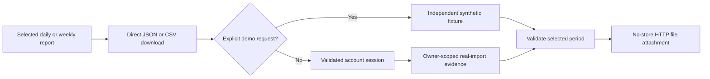

Validation: 48 tests, lint, TypeScript and Webpack production build pass. Production-build HTTP checks received both demo files on disk; an independent Python Decimal/CSV comparison verified 12 synthetic slices and exact gross INR 890 against the JSON report. The CSV UTF-8 BOM and unavailable-costs label are retained. Signed-out account requests return 401, invalid periods return 400, and neither returns an attachment. Server-rendered Reports contains the new file links and free computed reviews. Tests cover owner/demo separation, exact prices, spreadsheet-formula protection and safe error responses.

This verifies local HTTP file receipt/content, not a hosted signed-in browser download or OS print operation. Browser-control tools are unavailable in this session; real statement upload/save/reload, private journal/snapshot file receipt, print/PDF and physical-mobile acceptance remain pending. Existing snapshot persistence/deduplication acceptance from 10 October remains valid. No migration, paid service or private financial upload is required for this phase. Next: hosted report attachment verification, then the remaining owner/device acceptance checks when browser access is available.

Hosted follow-up: public demo JSON/CSV attachments returned HTTP 200 after rollout. Downloaded hosted CSV matched the local CSV byte-for-byte, and an independent Decimal comparison matched its 12 slices and INR 890 gross to hosted JSON. Signed-out private report export returned 401 without an attachment. This closes public HTTP report-file receipt/content acceptance; signed-in browser receipt and the other device/private-data checks remain pending.

### Private saved-record and journal downloads — 15 October 2026

Journal/plan, frozen snapshot and parsed broker-statement JSON now use direct same-origin HTTP file attachments. Settings links to `/api/exports/journal`; saved report and statement links use `/api/exports/saved` with a validated record kind/UUID. Each saved-record query filters both the validated owner and record ID before returning a schema-checked payload. Another owner's record and an absent record return the same 404 response. Snapshot exports preserve the saved payload and creation time; they do not recompute current trading history. Statement exports contain only the saved parsed record, not the source workbook or client identifier.

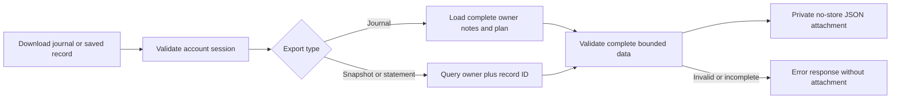

Journal row/byte limits remain unchanged. Unauthenticated requests return 401; saved-record input errors return 400; unreadable or inconsistent data never yields a partial attachment. File responses use no-store caching, JSON content type and MIME sniffing protection. The optional paid adapter still uses its older page-local download helper, but is disabled in the free edition.

Validation: 53 tests including five new private-download cases; lint, TypeScript and Webpack production build pass. Tests verify auth before saved-record reads, owner/ID filtering, indistinguishable missing/other-owner results, exact frozen data and timestamps, statement totals, safe failures and journal limit handling. No migration or grants changed, no paid service was enabled, and no owner data was uploaded. Signed-in browser file receipt, real statement upload/save/reload, phone and print/PDF acceptance remain pending because browser-control tools are unavailable. Next: those owner/device acceptance checks; do not count synthetic test responses as proof of a hosted owner download.

Local production HTTP verification: journal, snapshot and statement endpoints returned 401 without credentials; malformed saved-record input returned 400. All errors had no attachment, no-store caching and MIME sniffing protection. The existing public demo report download still returned its expected synthetic summary. Successful signed-in private file receipt remains pending.

Hosted follow-up: after rollout, journal, saved-snapshot and saved-statement export endpoints all returned 401 without credentials, with no attachment and no-store caching. This verifies hosted access denial only; successful owner download remains pending.

### Statement ledger validation and persistence checks — 15 October 2026

Fixed two import-validation gaps: a supplied other-debit/credit ledger is now checked even when its summary adjustment is zero, and posting dates must be real calendar dates inside the statement period. Offset debit/credit entries are accepted when they reconcile to zero; inconsistent zero summaries, negative debit/credit columns, incomplete amount-bearing rows and ambiguous ledger headings fail explicitly. A zero-adjustment report without an other-ledger sheet remains supported.

Stored statement validation also rejects impossible periods, negative charges/fee rows, blank labels and duplicate charge/instrument breakdowns, including labels differing only by surrounding whitespace. Parsed and reloaded/exported statements share these checks. Net arithmetic and the separation between statement-level net and execution gross are unchanged.

```mermaid
flowchart LR
    File[Original supported F&O XLSX] --> Summary[Exact summary and breakdown checks]
    Summary --> Ledger[Validate supplied ledger even for zero adjustment]
    Ledger --> Date[Real dates and nonnegative debit-credit columns]
    Date --> Total[Exact adjustment reconciliation]
    Total --> Preview[Preview without persistence]
    Preview --> Confirm[Owner confirmation]
    Confirm --> Save[Owner-scoped save]
    Save --> Repeat[Same file reuses record]
    Repeat --> Reload[Reload owner history]
```

Validation: 57 tests, lint, TypeScript and Webpack production build pass. The statement server actions now have a local PostgreSQL integration test using synthetic OOXML fixtures and the actual migration: preview does not save, ownership confirmation is required, repeated saves reuse ID/timestamp, saved values reload exactly, accounts remain isolated, and malformed/oversized/mismatched files do not add records. This test exercises the actual parser/actions with a small Supabase-shaped SQL adapter; it is not a hosted Supabase/browser acceptance test. The original owner workbook was rechecked read-only, with unchanged bytes and an independent source-cell Decimal comparison; it was not uploaded or committed.

Local production HTTP checks verified the synthetic costs page, signed-out login redirect for Costs and denied private statement download. No production data, migration or grants were changed, and paid AI remains disabled. Remaining acceptance: real hosted statement upload/save/reload, signed-in file receipt, print/PDF and physical phones. Browser-control tools remain unavailable. Next: complete those checks when account/browser access is available.

### Eight-step report and download batch — 15 October 2026

| Step | Result |
| --- | --- |
| 1. Download feedback | Free report/journal/snapshot/statement links announce a download request without claiming receipt; ordinary attachment links still work without JavaScript. |
| 2. Export error recovery | Browser requests receive a responsive login/retry/back screen; API callers retain JSON errors and original status codes. Errors never become attachments. |
| 3. Current report print view | Reports opens a dedicated selected daily/weekly review, with metrics, daily/cumulative evidence, prompts and scope limits. Full report history and workspace navigation are excluded. |
| 4. Frozen snapshot printing | Saved report history links to a printable frozen snapshot using the same owner-and-record reader as saved exports. Later imports do not change its printed evidence. |
| 5. Public demo support | Explicit demo print requests read only synthetic fixtures. Account print views require a validated session; mixed demo/snapshot selections are rejected. |
| 6. Mobile and paper styles | Responsive preview, touch-sized controls, white paper styles, hidden toolbars, repeated table headings and row-break rules implemented. Physical-device and actual PDF visual checks remain pending. |
| 7. Integrity and verification | Snapshot validation reconciles gross profit/loss, win rate, profit factor, day/slice totals, cumulative values, real dates and Monday-start weekly bounds. 64 tests plus required app checks pass. |
| 8. Documentation and delivery | README diagrams and acceptance checklist updated; verified batch committed/pushed through the normal phase workflow. |

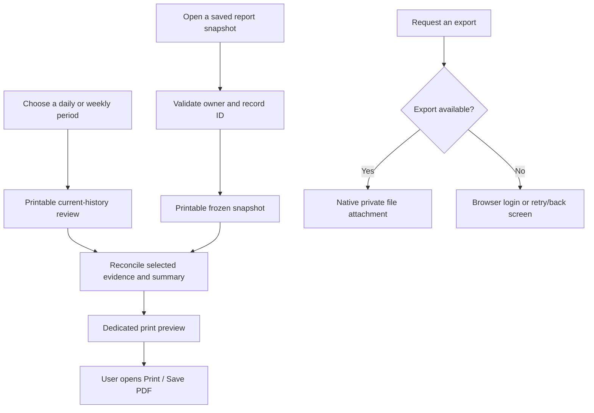

[Open the synthetic weekly print example](https://trademirror-ten.vercel.app/print/report?mode=weekly&date=2026-10-05&demo=1). Private print URLs use the validated account session; snapshot identity alone grants no access. `/print` participates in session refresh and no-store response handling. Printable output is aggregate execution evidence, not journal notes, raw CSV or a broker-certified net statement. Printing is user initiated; no PDF provider is called and paid AI stays disabled.

Validation: 64 tests, lint, TypeScript and Webpack production build pass. Local production HTTP checks verified daily/weekly demo print HTML, matching selected values, login redirects for private current/snapshot print, rejection of malformed/mixed-source requests, browser HTML versus API JSON error negotiation, and unchanged successful attachment responses. Static React rendering checks scope labels, frozen values, escaped error content and print controls. Shared saved-record reader tests retain cross-owner isolation. No production uploads, schema grants, paid service, or database migrations were added.

Limits: browser control is unavailable in this session. Actual print-dialog/PDF pagination, live click-feedback announcements, signed-in private file receipt, real statement upload/save/reload and physical-phone acceptance are still pending; server HTML and unit tests do not prove those checks. Existing snapshots are validated more strictly on read, without rewriting them. Inconsistent records fail visibly rather than printing misleading totals. V2/V3 remain planned. Next: owner/browser/device acceptance of the now-reviewable print/download flow.


### Hosted owner acceptance follow-up — 15 October 2026

Browser access became available for this follow-up. Signed-in current report JSON and saved snapshot JSON were received as actual local files. Independent Decimal checks reconciled report daily gross totals, profit minus loss and slice counts; the frozen snapshot matched every summary field, period and scope, preserving its original saved timestamp. Private download artifacts remain outside Git. The live report download link displayed its request feedback.

The authenticated frozen-snapshot print preview rendered the saved period, timestamp, scope, metrics and daily evidence correctly; this is preview acceptance only. The print action timed out without a verified dialog/PDF. Report CSV and journal receipt attempts also timed out, so their receipt remains unverified. No source workbook was uploaded: Chrome still requires the ChatGPT extension's “Allow access to file URLs” permission. No permission was changed.

Validation: actual owner JSON receipts and exact content comparison; hosted preview inspected visually and through accessibility text. Documentation-only follow-up; the preceding 64-test/lint/TypeScript/build results remain the app baseline. Next: enable file upload access with owner approval, complete real statement preview/save/repeat/reload, verify remaining exports and actual PDF/physical-phone behavior. V1 remains a candidate; V2/V3 remain planned.


### Real hosted statement acceptance — 15 October 2026

After the owner enabled Chrome file access, the original Zerodha F&O workbook was selected and previewed successfully on the authenticated hosted app. Preview totals matched the previously verified local source values. Ownership-confirmed save succeeded; repeating Save retained a single report version, the same record link and original saved timestamp. A full page reload followed by Load statements restored the same period, exact totals and mismatch warning. Parsed statement data is now saved in the owner account; the app does not retain the original workbook or client identifier.

The execution-versus-statement mismatch remains visible and costs are not allocated to executions or days. Statement JSON download receipt timed out and remains unverified. Private workbook, amounts, account identifiers and screenshot evidence are excluded from Git. This documentation-only phase records live UI acceptance; the preceding 64-test app validation baseline is unchanged. Next: remaining CSV/journal/statement receipt, actual PDF and physical-phone acceptance.


### Remaining desktop exports and PDF acceptance — 15 October 2026

Signed-in report CSV, journal/plan JSON and saved statement JSON were received as actual local browser attachments. CSV row count and exact Decimal gross sum agree with the downloaded report JSON. Statement amounts match the previously verified source and reconcile gross minus charges plus other adjustments to net. Journal JSON parses successfully and includes annotations, notes/tags/checklists, evidence/connection fields and the saved plan; no journal content was modified. Together with prior current-report and frozen-snapshot JSON receipts, all implemented export families now have successful owner receipt evidence.

The actual Chrome Print / Save PDF action opened the native print preview and saved a two-page PDF locally. Both generated pages were rendered and visually inspected: metrics, complete daily table, review prompts and scope limits are legible without clipping. The review prompts continue onto page two at the browser's default print settings; browser headers/footers remain user-controlled. No external PDF provider was used.

At an effective 390 × 844 browser viewport, Reports and print preview fit without horizontal page overflow. Mobile bottom navigation and opening/closing the navigation drawer work. The override was reset after checking. These are emulated Chrome checks, not physical iOS Safari/Android acceptance. Actual phone file selection, downloads and print/share behavior remain the final device checks; connected physical devices were not available.

Documentation-only acceptance phase: private downloaded files, PDF, account values and screenshots remain outside Git. The existing 64-test/lint/TypeScript/production-build baseline is unchanged. No paid service, new permissions, migration or account data edits were introduced. Next: owner physical-device smoke checks; V2/V3 remain planned.


### Review expansion: holding-time breakdown — 15 October 2026

Dashboard → Breakdowns → Holding time compares recorded gross contributions, slice counts and win rates in chronological duration groups: under 5 minutes, 5–15, 15–60, 1–4 hours, 4–24 hours and 24 hours or longer. Existing date, instrument, side and option filters apply before grouping. Account and independent public-demo dashboards share the implementation. Empty groups are omitted; invalid/reversed timestamps are labelled Unavailable rather than treated as zero duration.

Durations measure elapsed entry-to-exit time for each FIFO slice, including nights/weekends; intervals include their lower boundary and exclude their upper boundary. They are descriptive observations, not recommended holding periods. Costs/net and whole-position durations are not inferred. No migration, new permission or paid integration is needed. This ships one review-workflow expansion from the proposed V2 scope; broker sync and other V2/V3 work remain planned.

Validation: 65 tests, ESLint, explicit TypeScript and Webpack production build pass. Tests cover exact bucket boundaries, equivalent timezone instants, invalid/reversed inputs, empty scope, precise sums, grouping order and unchanged source data. Production-build Chrome demo acceptance verified 48 slices grouped into two durations, CE filtering to 24 slices with matching totals, and a 390px page without horizontal overflow. Physical-device checks remain in the handoff note. Next: date-period/session comparison or a separately scoped broker-sync integration.


### Module 1 — Period comparison

Dashboard Compare periods supports Monday-start weeks and calendar months, selected after current analysis filters. Compare slice count, gross P&L, win rate, profit factor, independent drawdown, holding time and active exit days; swap periods or open their journal date ranges. Exact gross difference uses decimal arithmetic. Partial/missing periods and journal-link filter limits are explicit. No migration or paid integration. Validation: 66 tests, lint, TypeScript and production build; production UI verified weekly/monthly values, swap and date links. Next: saved journal review module.


### Module 2 — Saved journal review

Private `/journal-review`, linked from Settings and saved-note connection status, displays retained notes/tags/checklist questions and evidence status. Search notes/symbols, filter by tag or linked/unlinked evidence and page 20 entries at a time. Unlinked notes keep their content without inferred instruments or dates; no automatic reassignment. Uses the existing owner-validated complete export with 1,000-entry/5 MB limits; errors show no partial review. No migration or new writes. Validation: 68 tests, lint, TypeScript, production build and anonymous route redirect. Hosted signed-in UI acceptance follows rollout. Next: reusable plans and recorded risk inputs.


### Module 3 — Plan library and recorded risk

Multiple private checklist templates can be created/updated at `/plans` or selected from the journal plan editor. A template is applied to a slice only through the explicit reset-questions action; existing questions stay frozen. The separate risk editor records optional stop price, target price and INR risk budget for exact FIFO evidence. Blank differs from zero; no stop execution, sizing, compliance or pre-entry provenance is inferred. Unsaved risk drafts participate in the journal close guard. Settings offers a separate bounded library/risk JSON export; the original journal export format is unchanged.

Migration `202610150001_review_modules.sql` is prepared and tested, not yet applied to production. Until applied, private library/risk loading fails visibly; demo functionality remains independent. New tables have owner-only RLS, column grants and revision checks. Validation: 70 tests, lint, TypeScript and production build; actual demo template create/select and risk save verified. Local anonymous `/journal-review` returned 307 to login, confirming the Module 2 route check after the initial sandbox-network attempt failed. Live migration and owner persistence await action-time approval. Next: process tracking from recorded questions.


### Module 4 — Recorded process tracking

Saved journal review now summarizes checked/recorded answers by exact question text and linked IST exit week. Existing search/tag/connection filters apply to both entries and summary. Unlinked evidence is excluded only from dated trends; its saved answers remain inspectable. Unchecked may mean unassessed, retrospective entries do not prove pre-entry compliance, and no discipline/rule-violation score is invented. The existing performance review now respects its selected date range. An independent `/demo/journal-review` uses three synthetic entries without account reads/writes.

Validation: 71 tests, lint, TypeScript and production build; actual UI verified linked/unlinked counts, empty search, weekly exclusions and 390px layout without overflow. No migration or new permissions. Next: broker sync pilot with explicit configuration/access limits.


### Module 5 — Broker sync pilot

Settings → Broker connections implements an opt-in, operator-configured, single-owner current-day Kite execution preview/save flow. It verifies broker profile ownership first, bounds responses/timeouts, retains numeric lexemes, validates supported NFO/BFO rows through Console normalization and counts excluded markets. Saving re-fetches a fingerprint and uses the existing atomic duplicate-safe import RPC. Broker reads use fixed GET endpoints only; no order actions. Default is disabled and CSV remains free.

[Setup and limits](docs/BROKER_SYNC.md): current-day trade access and daily session expiry follow official Kite docs. This is not multi-user OAuth, historical backfill or unattended sync. Live developer access/credential configuration and acceptance remain blocked; no credentials, subscription or broker requests were created for the owner. Validation covers exact normalization, account mismatch before trades, expiry/rate/size failures and the action enable/owner/confirmation/fingerprint guards with mocked transport. Required app checks and route denial are recorded at this checkpoint. Next: PWA installation and private-data-safe offline fallback.


### Module 6 — Installable PWA

`/install` offers the native install prompt where available, Android/desktop menu instructions and Safari home-screen steps. Manifest, 192/512px icons, maskable/Apple icons and a root-scope service worker are included. Updates are checked explicitly and never force a reload until the user applies them after saving drafts. Only public fallback/icons are cached; private navigations are network/no-store, while API/auth/export/write requests bypass the worker. Offline mode is a generic reconnect screen, not a cached account dashboard or pending-write queue.

Validation: 76 tests, lint, TypeScript and production build; VM worker lifecycle tests verify private-data exclusion, offline fallback and unrelated-cache preservation. Local production HTTP verified manifest/icons/offline MIME types and no-cache worker headers. Chrome offered the actual install prompt and its update action reported readiness; physical installation and real-device offline/update checks remain deferred. The viewport override did not take effect for this install-page run, so no new phone-layout acceptance is claimed for this module. No paid service or notification permission.

[Six-module status, diagram and activation notes](docs/MODULE_BATCH.md). Module 3 migration is now applied with explicit approval; live RLS/policy verification passed, superseding the earlier prepared-only entry. Module 5 remains disabled pending broker access. Next: hosted owner library/risk/review acceptance and physical-device checks when available.


### Six-module final acceptance follow-up

78 tests, lint, TypeScript and production build pass. Hosted owner journal review, starter template save/reload, exact risk persistence on existing synthetic example evidence, and actual library/risk export receipt are accepted. Synthetic risk test values were cleared back to blank; existing real trades and journal notes were not changed. Full-history journal links now include examples where needed, and period links preserve explicit example scope. The new regression tests cover those links and IST exit dates. Hosted PWA manifest/install prompt are available. Live broker authorization and physical device/offline/update installation remain open; see the module handoff.
