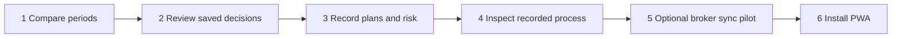

# Six-module batch — 15 October 2026

Each module has its own ordered commit. These expand the accepted free desktop V1; they do not retroactively claim every proposed V2 capability is complete.

| Module | Implemented | Activation / acceptance limits |
| --- | --- | --- |
| 1. Period comparison | Weekly/monthly gross comparison, independent metrics, swap and date links | Browser production demo passed; no capital return or net inference |
| 2. Saved journal review | Private search, tags, linked/unlinked retention, pagination | Owner-only loader and anonymous redirect; bounded 1,000-note export source |
| 3. Plan library / risk | Multiple templates, explicit per-slice stop/target/budget, independent export and draft guards | Migration applied after explicit confirmation; RLS enabled and 3 policies per table verified. Live owner save acceptance is tracked below |
| 4. Recorded process | Question-wise checkbox completion, linked weekly trend, filter integration | Self-reported, no compliance/discipline score; unlinked evidence excluded from dated trends |
| 5. Broker sync pilot | Guarded current-day Kite preview/refetch/save with existing deduplication pipeline | Disabled by default. Owner developer access and server configuration missing; no live API acceptance, OAuth or background sync claimed |
| 6. PWA | Manifest/icons, install instructions/prompt, explicit update controls, generic offline fallback | Local Chrome install prompt offered and worker update action verified; physical installation/offline tests remain deferred |

## Live migration

`202610150001_review_modules.sql` was applied to project `kddtnalvzqlxrtuneasp` after explicit action-time approval. A read-only schema query confirmed both new tables have RLS and three owner policies. Existing executions/notes grants were not changed. A repeated editor execution was rejected because the table already existed; the editor was fully replaced and an isolated verification query succeeded. No destructive schema repair was performed.

## PWA privacy and lifecycle

Only `/offline.html` and the named public icons are cached by the worker. API/auth/export requests, writes, third-party requests and financial records never enter its cache. Private navigations use network/no-store and fall back to a generic offline page if the connection fails; no writes are queued and an interrupted save is never represented as success. Other apps' caches are preserved. App updates wait for a user action; save drafts before applying/reloading.

Implementation follows the [Next.js PWA guide](https://nextjs.org/docs/app/guides/progressive-web-apps). Safari installation instructions follow [Apple's home-screen web app guide](https://support.apple.com/guide/iphone/open-as-web-app-iphea86e5236/27/ios/27). There are no push subscriptions or native app-store packages. When changing precached assets in a future release, bump the worker cache version and recheck its allowlist.

## Deferred prerequisites

- Physical iOS Safari / Android Chrome installation, launch, file picker, download and print/share checks require real devices. Emulation is not a substitute.
- Local worker offline behavior is exercised through isolated lifecycle/network tests. Real-device offline transition and update installation remain manual acceptance items.
- Broker sync remains disabled until owner-supplied supported API access is configured through an approved secure process. Never paste keys/tokens into chat or commit them. CSV remains available without it; see [broker setup](BROKER_SYNC.md).
- Manual note reassignment, full backup restore, verified rule compliance, multi-user OAuth, unattended broker jobs and broker-certified cost allocation remain outside this batch.
